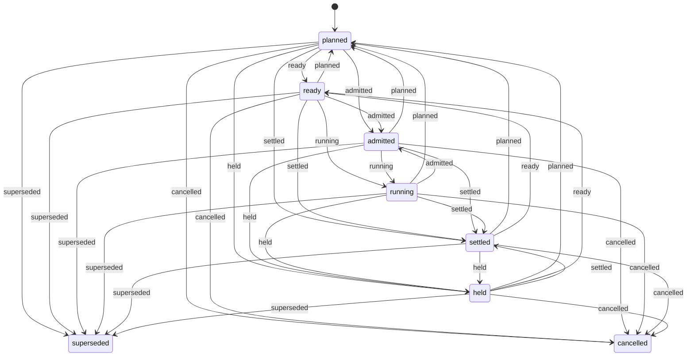

<!-- Generated by scripts/machine-charts.mjs from packages/coding-agent/src/core/plan/plan-node-machine.ts. Edit the declared table, then run node --conditions=pi-source scripts/machine-charts.mjs. -->

# plan-node

