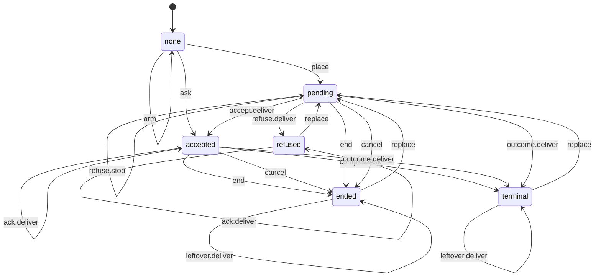

<!-- Generated by scripts/machine-charts.mjs from packages/coding-agent/src/core/remote/remote-job-delivery-model.ts (placer projection). Edit the declared table, then run node scripts/machine-charts.mjs. -->

# remote-job-delivery

