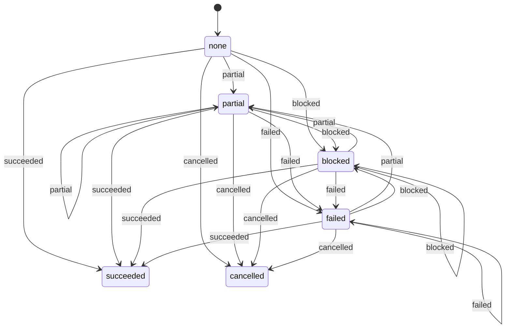

<!-- Generated by scripts/machine-charts.mjs from packages/coding-agent/src/core/delegation/worker-outcome-machine.ts. Edit the declared table, then run node scripts/machine-charts.mjs. -->

# worker-outcome

